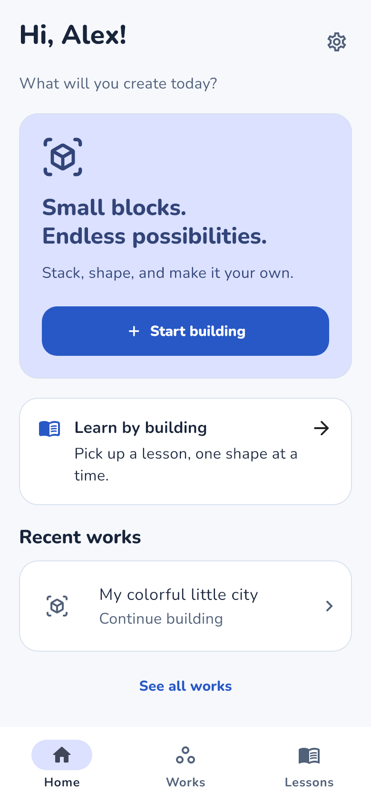
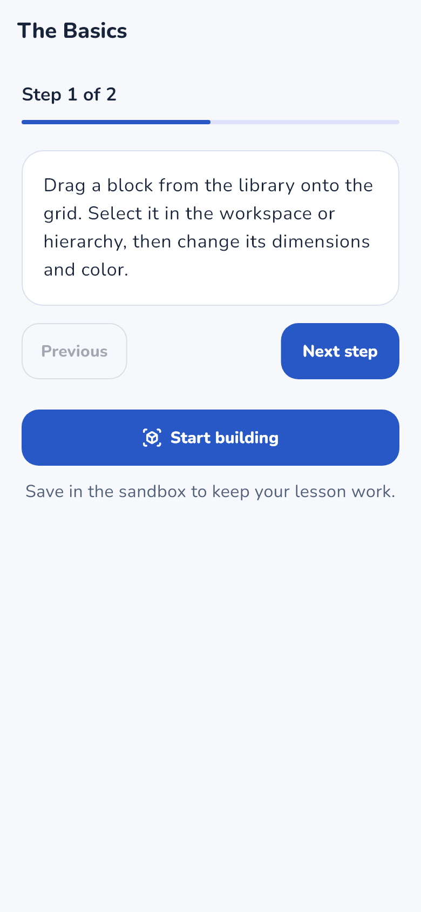
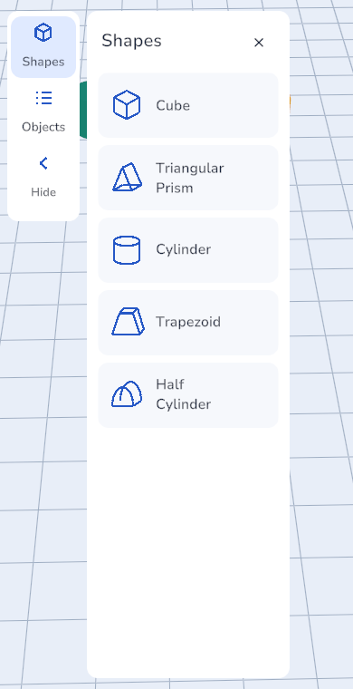
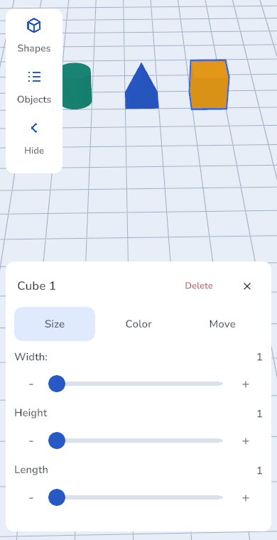
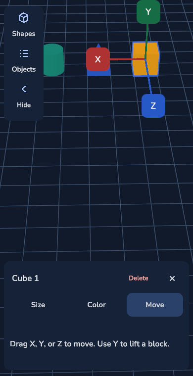
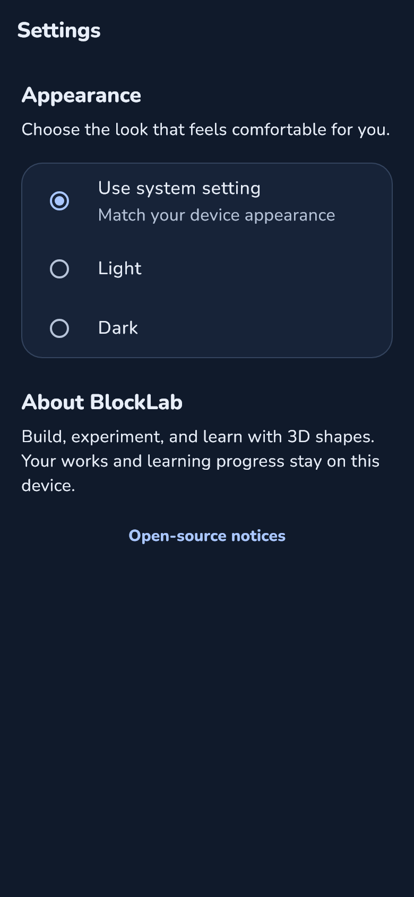

# BlockLab

BlockLab is an Android app for learning and creating with 3D building blocks. It is designed for elementary through high school learners and anyone who enjoys building. Flutter provides the app interface and lessons; Unity powers the editable 3D sandbox.

## Features

- Build with Cube, Triangular Prism, Cylinder, Trapezoid and Half Cylinder shapes.
- Move, resize, recolor and delete blocks, with undo, redo and X/Y/Z move handles.
- Follow seven guided lessons directly in the sandbox or create freely.
- Save and reopen editable builds, and export or import them as JSON.
- Choose a camera angle and share a picture of your build.
- Choose Light, Dark or System appearance.

## Screenshots

| Home | Guided lessons | Shape library |
| :---: | :---: | :---: |
|  |  |  |

| Resize blocks | X/Y/Z move handles | Dark mode settings |
| :---: | :---: | :---: |
|  |  |  |

*Flutter UI previews and Unity Editor captures with sample content.*

## Build and run

The build scripts support **Windows with PowerShell 7**. To run the APK, use an **ARM64 Android device running Android 10 or later**.

### Prerequisites

- Unity **2022.3.62f3**, installed through Unity Hub with an active license and the **Android Build Support**, **Android SDK & NDK Tools**, and **OpenJDK** modules.
- PowerShell **7**.
- Python **3.11 or later**.

The setup script downloads Flutter **3.41.4**, JDK 17 and the remaining Android build tools.

### Build the APK

Clone or download this repository, then open PowerShell 7 in its root folder. Save and close the project's Unity Editor before building.

```powershell
# Run once to set up the local build tools.
.\scripts\bootstrap-tools.ps1

# Export Unity and build the Android app.
.\scripts\build-apk.ps1
```

The debug APK will be created at:

```text
flutter_app/build/app/outputs/flutter-apk/app-debug.apk
```

The first build can take several minutes while dependencies and Unity's native code compile.

### Install on Android

Enable USB debugging on your phone, connect it to your computer, and run:

```powershell
.\.tools\android-sdk\platform-tools\adb.exe devices
.\.tools\android-sdk\platform-tools\adb.exe install -r .\flutter_app\build\app\outputs\flutter-apk\app-debug.apk
```

Open **BlockLab** on the phone. This APK is debug-signed for testing.

## Using BlockLab

1. Enter a name and choose **Start building**, or open **Lessons** for guided activities.
2. Open **Shapes** and drag a shape sideways onto the grid. Tap a block, or its name in **Objects**, to open properties. Properties stays hidden during dragging and after a drop. Use **Size** for dimensions, **Color** for colors, and **Move** for X/Y/Z handles. Resizing carries supported blocks above it and stops if there is not enough space.
3. Drag empty space to orbit, pinch to zoom, and move two fingers to pan. More controls are explained in **How to build** in the sandbox menu.
4. Tap **Save** before leaving. Reopen creations in **My works**, where you can also rename, delete or import builds.
5. Choose **Share picture** from a build's menu or the sandbox menu. Orbit, zoom and pan to frame your build, then share the picture. Choose **Export editable build** in **My works** to send a `.blocklab.json` file that another user can import and edit.
6. Open **Settings** from Home or the sandbox menu to change the appearance.

In a lesson, use the guide above the workspace to change steps or open a reference image. You can collapse it while building; your current step is saved.
